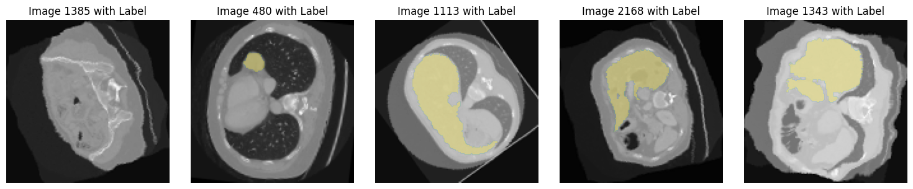
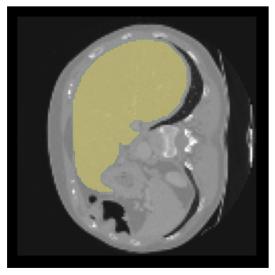
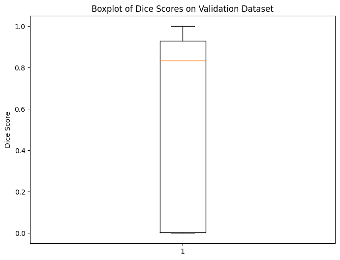

# Liver Segmentation from 3D CT: DICOM to NIfTI to U-Net

An end-to-end medical imaging pipeline that turns raw CT scans from different scanners into a consistent dataset, trains a U-Net to outline the liver, and judges it only on patients it has never seen.

**Stack:** Python, PyTorch, pydicom, SimpleITK, dicom2nifti, nibabel, SciPy, imgaug, TensorBoard



---

## The problem
CT scans come from different scanners with different voxel sizes and slice thicknesses. A model trained on unstandardised volumes learns the scanner, not the anatomy, and a slice-level train/test split leaks the same patient into both sets.

## Data
[3D-IRCADb-01](https://www.ircad.fr/research/data-sets/liver-segmentation-3d-ircadb-01/): contrast CT for 20 patients, stored as DICOM series with expert liver masks (2,823 slices in total). The data is not included in this repository; download it from IRCAD and use `src/extract_and_rename_3d_ircadb.py` to set up the folder structure.

## Pipeline
| Step | Notebook | What it does |
|---|---|---|
| 1 | `01_dicom_to_nifti` | Reads DICOM headers and series, rebuilds 3D volumes, converts CT and masks to NIfTI, binarises masks |
| 2 | `02_resample_normalise_split` | Audits every volume, resamples to 2.5 mm in-plane, normalises, pads or crops to 128 × 128, splits by patient |
| 3 | `03_dataset_explore` | Visual checks of slices and masks after preprocessing |
| 4 | `04_build_unet` | U-Net with three encoder levels (64, 128, 256 filters), skip connections, sigmoid output |
| 5 | `05_train` | Augmentation, combined BCE + Dice loss, Adam, 20 epochs, TensorBoard logging |
| 6 | `06_evaluate` | Dice per validation slice, then a full held-out volume rebuilt and reviewed slice by slice |

**Key decisions**
- Measured scanner variation before modelling: in-plane spacing 0.56 to 0.87 mm, slice thickness 1.0 to 4.0 mm, 74 to 260 slices per volume.
- Resampled CT with quadratic interpolation but masks with nearest-neighbour, then checked masks were still strictly 0/1.
- Split at **patient level**: 16 training patients (2,241 slices) and 4 unseen validation patients (582 slices).
- Augmentation (scaling, rotation, elastic deformation) on the training set only, applied identically to image and mask.



## Results
- **Mean Dice 0.631 (SD 0.395)** across 582 validation slices from 4 unseen patients.
- The median slice scores well above the mean, and the wide spread comes from slices at the edge of the liver and slices with little or no liver, where a small error swings Dice towards 0. That spread is why the evaluation goes beyond one number to a full-volume visual review.



## Limitations and next steps
- The model is 2D and works slice by slice; Dice is reported per slice, not as per-patient volumetric Dice.
- Next: per-patient volumetric Dice, analysis of failing slices, and a 2.5D or 3D model (for example MONAI or nnU-Net).

## Repository structure
```
notebooks/   six notebooks, run in order
src/         dataset, model, plotting and data setup helpers
figures/     figures exported from the notebooks
```
Model weights and data are not included.

## How to run
```bash
pip install -r requirements.txt
python src/extract_and_rename_3d_ircadb.py   # after downloading 3D-IRCADb-01
jupyter notebook notebooks/01_dicom_to_nifti.ipynb
```

## Data credit
Soler L. et al., 3D-IRCADb-01, IRCAD France.

## Author
**Judah Akinlaja**, Health Data Scientist
[LinkedIn](https://www.linkedin.com/in/judah-akinlaja-a10385194) · [Portfolio](https://judahakinlajar.co.uk) · [GitHub](https://github.com/Akinlajar)
